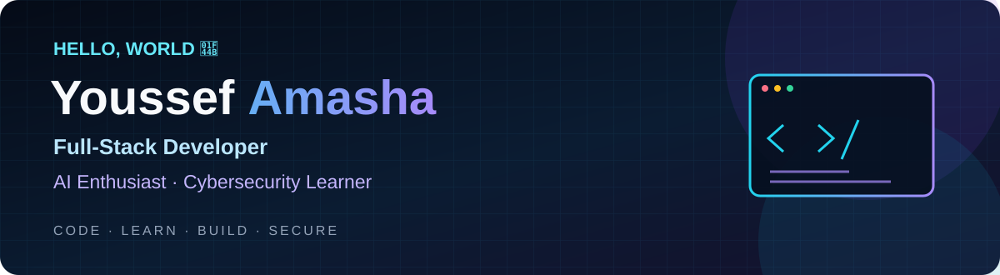

  
  
  

---

## 👋 Hey, I'm Youssef!

I'm **Youssef Amasha** (`Am3sha` on GitHub), a full-stack developer interested in building practical web products, exploring AI-powered workflows, and learning how to make applications more secure.

I enjoy taking an idea from the UI to the backend, connecting APIs and databases, and improving the product through hands-on building. I'm also exploring web application security and automation as part of my journey into cybersecurity.

- 🔭 **Building:** web applications and experimenting with security automation
- 🌱 **Learning:** AI integration, web application security, and cybersecurity workflows
- 🤝 **Collaboration:** full-stack apps, AI-powered tools, and open-source projects
- 💬 **Ask me about:** React, Next.js, Node.js, Express, REST APIs, and MongoDB
- ⚡ **Personal motto:** Code. Learn. Build. Secure. Repeat.

---

## 🚀 Featured Projects

<table>
<tr>
<td width="50%" valign="top">

### 🌐 HORAS-CERT
An ISO certification management platform for handling certification requests and issuing certificates with QR codes.

**Highlights**
- Certification request workflows
- Certificate pages and QR-code verification
- Admin dashboard

[Visit website ↗](https://horascert.com)

</td>
<td width="50%" valign="top">

### 🛡️ HunterAI
A Linux-first security reconnaissance tool manager, planned to organize security tools and support controlled recon workflows.

**Focus:** Python · FastAPI · Security tooling · Automation

*Currently in development.*

</td>
</tr>
<tr>
<td width="50%" valign="top">

### 📊 TRENNT
A corporate website with an integrated assessment and benchmarking experience to evaluate results and present structured reports.

[Visit website ↗](https://trennt.net)

</td>
<td width="50%" valign="top">

### 🤖 CareerFit AI
An AI-focused career platform concept for CV analysis and matching skills with career paths and opportunities.

[Open demo ↗](https://careerfit-ai-liart.vercel.app)

</td>
</tr>
</table>

---

## 🧰 Languages, Tools & Technologies

### Languages

  
  
  
  
  

### Frontend

  
  
  
  

### Backend & Data

  
  
  
  
  
  

### Tools & Interests

  
  
  
  

**Areas I'm exploring:** AI integration · Web application security · Bug bounty methodology · Security automation

---

## 📊 GitHub Statistics

 

---

## 🤝 Let's Connect

  
  
  

---

**Thanks for stopping by!**  
*Building a more useful and secure web, one project at a time.*

